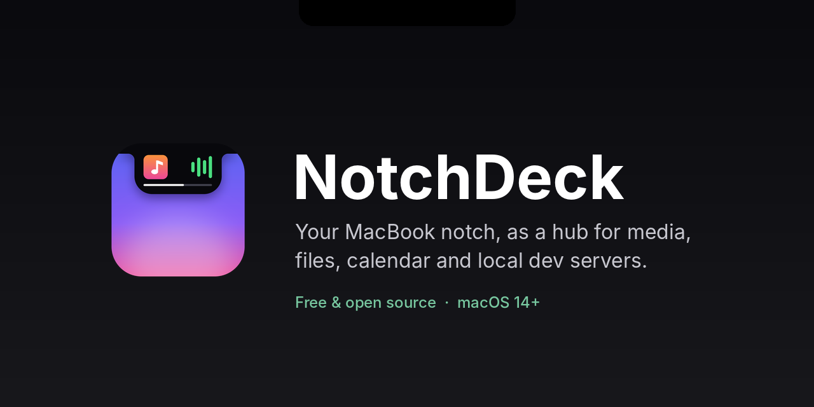
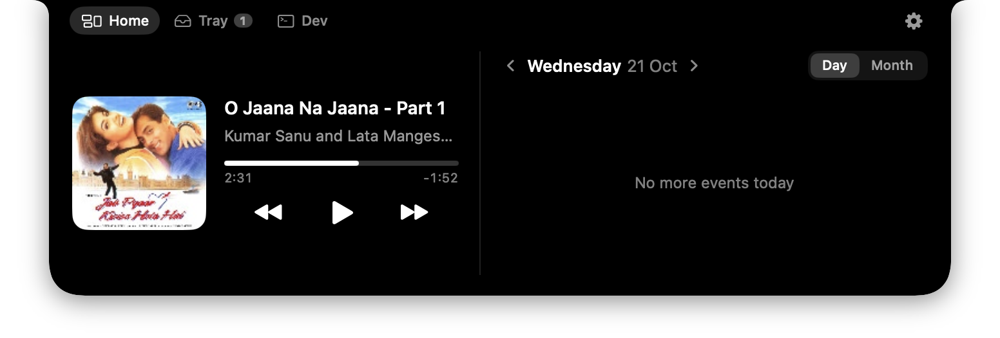
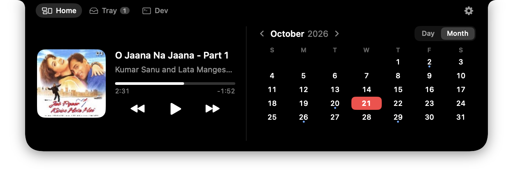
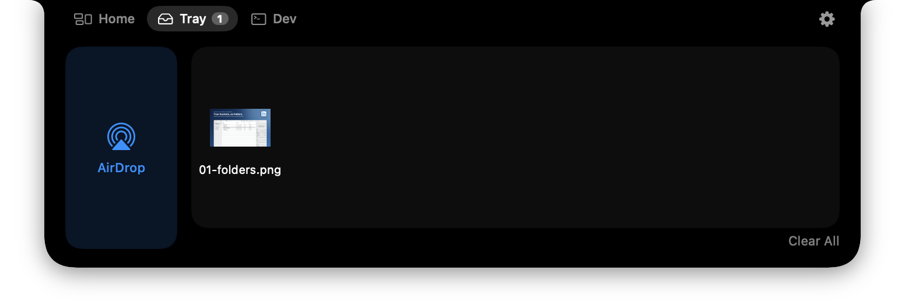
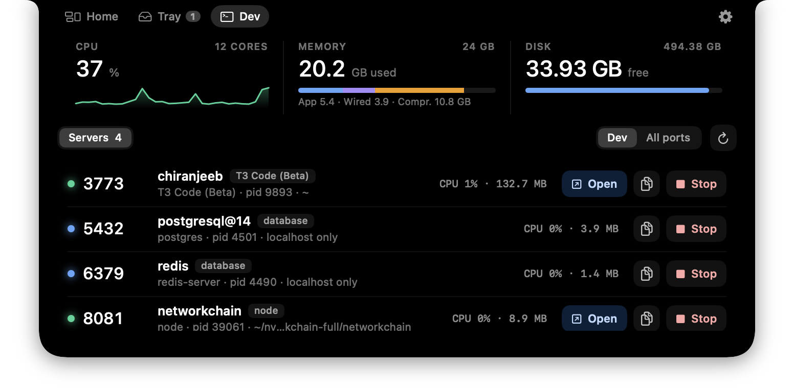
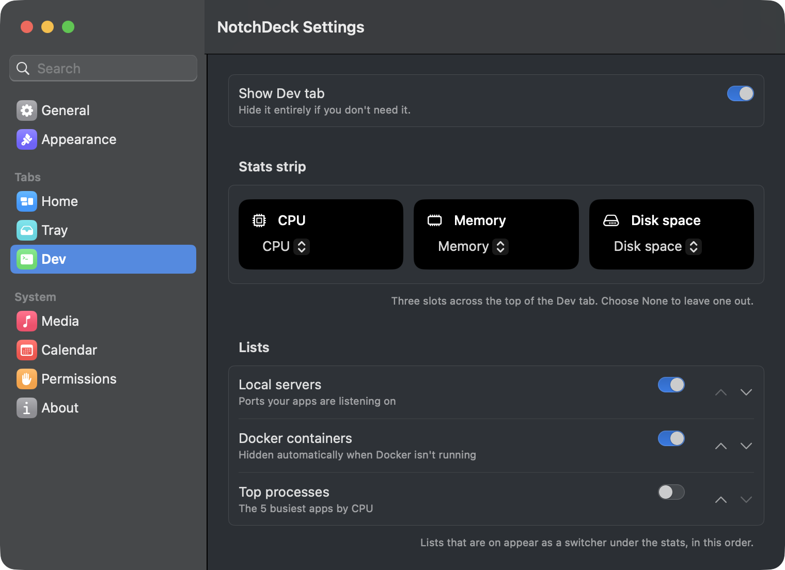

<p align="center">
  
</p>

<p align="center">
  <a href="https://chiranjeebhub.github.io/NotchDeck/"></a>
  <a href="https://github.com/chiranjeebhub/NotchDeck/releases/latest"></a>
  
  
  <a href="LICENSE"></a>
</p>

<p align="center">
  
</p>

## What it does

Move the pointer to the notch (or click it, if you prefer) and it opens into a small panel. Move away
and it tucks back in. Macs without a notch get a slim handle at the top of the screen instead.

- **Now Playing.** Artwork, title, progress with seeking, and play/pause/skip for whatever macOS
  is playing: Spotify, Music, Podcasts, YouTube in a browser and more. While music plays, the closed
  notch shows the album art and a live level meter.
- **Calendar.** Today's events in Day view, or a Month view with dots on busy days. Join buttons
  for Google Meet, Zoom, Teams and Webex links. Uses the calendars in the Calendar app, including
  Google accounts added there.
- **Tray.** Drag files onto the notch to keep them handy, then drag them out wherever you need
  them. Quick Look thumbnails, and an AirDrop tile for sending files to a nearby device.
- **Dev.** For developers: live CPU, memory, network, disk, battery, GPU or uptime at a glance,
  then the local servers listening on your Mac (`localhost:3000` and friends) with their project
  folder, CPU and memory, and Open, Copy URL and Stop buttons. Docker containers can be started,
  stopped and tailed, and a Top processes list shows what's busy.
- **Notes.** A scratch pad that saves as you type.
- **Make it yours.** A Settings window with a sidebar lets you hide tabs, choose the widgets on
  either side of Home, pick the three Dev stats, reorder the Dev lists, choose which calendars to
  show, and set hover or click to open.
- **Updates itself** through [Sparkle](https://sparkle-project.org).

## Screenshots

| Calendar month view | Tray |
|---|---|
|  |  |

**Dev tab:** system stats and the local servers running on your Mac.



**Settings:** pick what each tab shows.



## Install

**Download:** grab `NotchDeck-<version>.dmg` from the
[latest release](https://github.com/chiranjeebhub/NotchDeck/releases/latest), open it and drag
NotchDeck to Applications. It's signed and notarized by Apple, so it opens without warnings.

**Homebrew:**

```sh
brew install --cask chiranjeebhub/tap/notchdeck
```

NotchDeck lives in the menu bar, with no Dock icon. Use the menu bar icon or the gear in the notch to
open Settings.

### Permissions

- **Calendar:** asked the first time the Calendar widget needs it.
- **Automation:** only used to control Spotify or Music if system-wide Now Playing isn't available.

NotchDeck is distributed outside the Mac App Store because the App Store sandbox would rule out
system-wide Now Playing and everything in the Dev tab.

## Build from source

Requires macOS 14 or later and Xcode 15+ (or the Swift 5.9+ command line tools).

```sh
git clone https://github.com/chiranjeebhub/NotchDeck.git
cd NotchDeck
./scripts/build-app.sh
open build/NotchDeck.app
```

The local build is ad-hoc signed, so macOS may ask for permissions again after each rebuild.
Privacy prompts only work properly from the bundled `.app`, not when running from Xcode.

### Project layout

```
Sources/NotchDeck/
  App/       entry point, app delegate, settings keys
  Notch/     panel, per-screen controller (hover and drag detection), geometry, view model
  Services/  now playing, calendar, tray, ports, system stats, Docker, updates
  Views/     SwiftUI views for the notch and Settings
Adapter/     MediaRemote helper, run under /usr/bin/perl for system-wide Now Playing
Resources/   Info.plist, entitlements, AppIcon.png (drawn by scripts/render-icon.py)
packaging/   Homebrew cask
scripts/     build-app.sh (local build), release.sh (signed, notarized DMG)
```

See [docs/PLAN.md](docs/PLAN.md) for the feature roadmap.

## Releasing

`scripts/release.sh` builds a universal app and signs it (and Sparkle) with a Developer ID
certificate and the hardened runtime. It then notarizes and staples both the app and the DMG, and
writes a signed Sparkle `appcast.xml`. One-time setup is described at the top of the script.

For each release:

1. Bump `CFBundleShortVersionString` and `CFBundleVersion` in `Resources/Info.plist`.
2. Run `scripts/release.sh`.
3. Create a GitHub release tagged `v<version>` with the DMG and `build/appcast.xml` attached. The
   app reads its update feed from the latest release.
4. Update the version and `sha256` in the Homebrew tap's `Casks/notchdeck.rb`. The template is
   `packaging/homebrew/notchdeck.rb`.

## Contributing

Issues and pull requests are welcome. Please build with `./scripts/build-app.sh` and try your change
in the bundled app before opening a PR.

## License

[MIT](LICENSE) © Chiranjeeb Jena.
